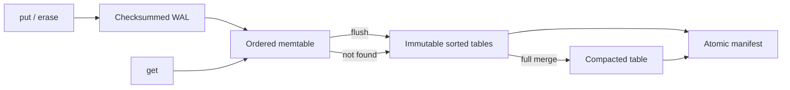

# Key-Value Store

[](https://github.com/Nagasai125/Key-Value-Store/actions/workflows/ci.yml)

A persistent, embedded C++17 key-value store built around a log-structured merge tree (LSM tree) and a write-ahead log (WAL). Includes a library, command-line tool, recovery tests, and a reproducible benchmark. Runs on Linux and macOS with no third-party runtime dependencies.

## What it does

- Binary-safe `put`, `get`, and `erase`, including empty keys and values.
- Ordered in-memory writes, immutable sorted tables, and full-merge compaction.
- Memory-mapped tables with a key index for binary-search reads.
- Checksummed WAL recovery, tombstones, and atomic manifest publication.
- Configurable synchronous or buffered writes; synchronous is the library default.
- Concurrent readers and serialized mutations through one shared store instance.
- Exclusive directory locking to prevent two store instances from writing the same database.

## Build and try it

Requires a C++17 compiler, POSIX APIs, and Make. The database directory's parent must exist.

```sh
git clone https://github.com/Nagasai125/Key-Value-Store.git
cd Key-Value-Store
make -j
make test

./build/kv_cli demo-db put language C++
./build/kv_cli demo-db get language        # C++
./build/kv_cli demo-db put language C++17
./build/kv_cli demo-db flush
./build/kv_cli demo-db get language        # C++17, read from a table
./build/kv_cli demo-db erase language
./build/kv_cli demo-db get language        # No output; exit status 1
./build/kv_cli demo-db compact
```

Each CLI command opens the database, performs its operation, and closes it. Exit codes: `0` success, `1` missing key, `2` invalid arguments or storage error. The C++ API supports binary data; the CLI accepts shell arguments.

Alternatively, with CMake 3.16 or newer:

```sh
cmake -S . -B build-cmake -DCMAKE_BUILD_TYPE=Release
cmake --build build-cmake --parallel
ctest --test-dir build-cmake --output-on-failure
```

## C++ API

```cpp
#include "kv/store.hpp"
#include <iostream>

int main() {
    kv::Store db("example-db"); // fsync the WAL after every mutation
    db.put("user:42", "Nagasai");
    if (auto value = db.get("user:42")) {
        std::cout << *value << '\n';
    }
    db.erase("user:42");
    db.compact();
}
```

Link against CMake's `kv_store` target, or after `make`, compile with:

```sh
c++ -std=c++17 -pthread -Iinclude example.cpp build/store.o -o example
```

For workloads that accept an OS/power-failure loss window:

```cpp
kv::Options options;
options.durability = kv::Durability::Buffered;
options.memtable_bytes = 4 * 1024 * 1024;
options.max_tables = 4;
kv::Store db("buffered-db", options);
db.put("event:1", "created");
db.sync(); // Explicit persistence boundary for previous buffered writes
```

`get` returns `std::nullopt` for a missing or deleted key. Failures throw standard C++ exceptions. Keys are limited to 1 MiB, values to 16 MiB. Destroying a store closes its files; it does **not** implicitly sync buffered writes. Call `sync()` and handle its result when persistence is required.

## Performance

The benchmark measures individual operations, so throughput is reported as **operations/second**, not multi-operation transactions. Published local results exceed **100K ops/s** for buffered writes and have **below 10 μs P99** for warm-cache reads. These are workload-specific measurements, not a universal latency guarantee.

See [measured results, hardware, and methodology](docs/benchmarks.md) and the [raw CSV files](bench/results/). Synchronous writes are reported separately. Flush and compaction stalls are included when they occur during the measured operation loop.

```sh
make bench
./build/kv_bench 100000 1000000 buffered
./build/kv_bench 100000 1000000 sync
```

Each run creates a fresh temporary database and removes only that generated directory when finished. No existing database is used.

## Storage design



Reads check the memtable, then tables from newest to oldest. A tombstone stops the search so deleted values cannot reappear from older tables. Once the memtable or WAL reaches the configured byte threshold, a synchronous flush publishes a new table. Reaching `max_tables` triggers a merge of all tables.

See [architecture, file formats, and crash ordering](docs/architecture.md).

## Verification

```sh
make test       # Reference-model, recovery, corruption, and concurrency tests
make sanitize   # Same suite with AddressSanitizer and UndefinedBehaviorSanitizer
```

Tests cover updates/deletes across flushes and restarts, empty and binary values, input limits, directory locking, randomized operations against `std::map`, all partial final-record lengths, corrupted records/tables/manifests, duplicate WAL replay, orphan tables, failed checkpoint publication, bounded WAL growth, concurrent access, and `SIGKILL` recovery. GitHub Actions builds and runs the suite on Linux and macOS.

## Scope and limits

This is a small, inspectable storage engine for systems programming and performance experiments.

- Embedded, single-process API; no network service, replication, transactions, snapshots, or range scans.
- Compaction is synchronous and uses memory proportional to live data. It blocks operations and can produce millisecond-scale tail stalls.
- The table index uses memory proportional to the number of records; mapped pages also consume the OS page cache. The flush threshold bounds serialized payload/log bytes, not total resident memory.
- All table checksums are verified at open time, so startup is proportional to table bytes plus the WAL.
- `Sync` uses POSIX `fsync`; actual power-loss behavior depends on the OS, filesystem, and device. Tests exercise process crashes, not physical power cuts.
- Buffered writes reach the OS through `write` before acknowledgment, but may be lost on an OS crash or power loss until `sync` or a checkpoint completes.
- Checksums detect accidental corruption and are not cryptographic. Store files must not be edited while the database is open. Local filesystems are the supported target.
- Interrupted publication may leave unreferenced table files on disk. They are ignored safely; automatic orphan collection is not implemented.
